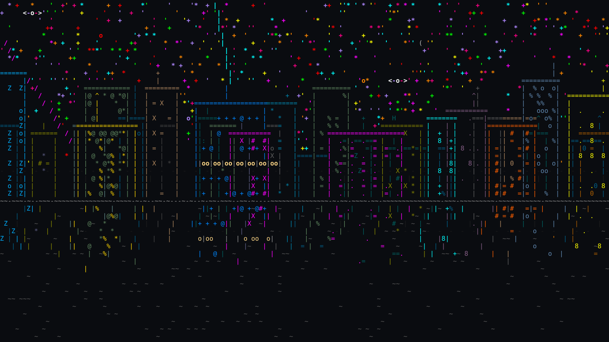
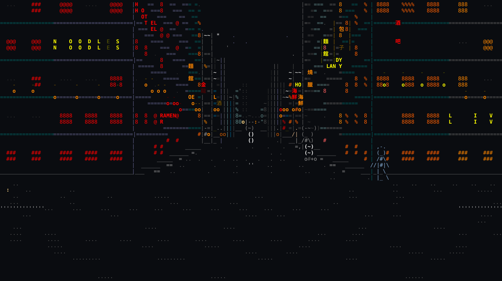
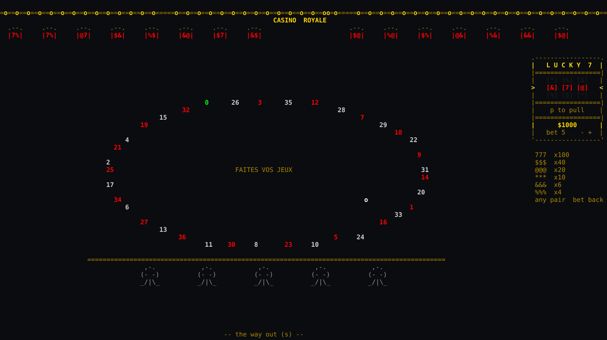
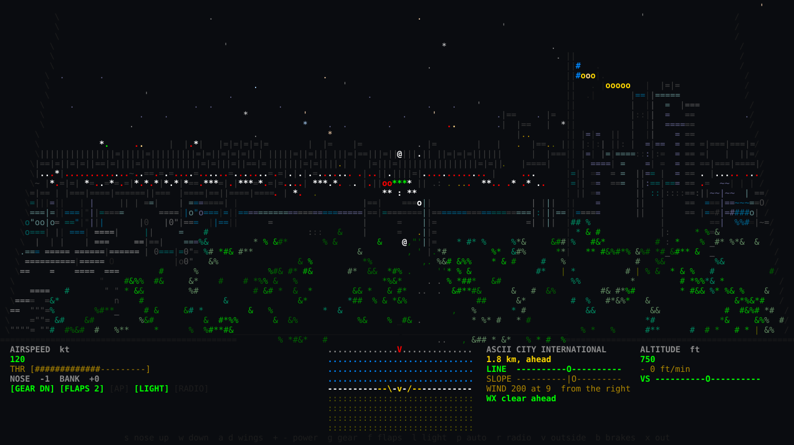
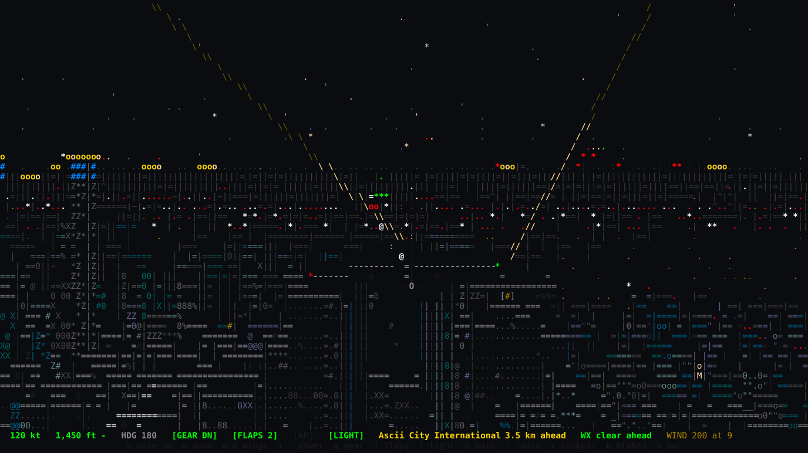
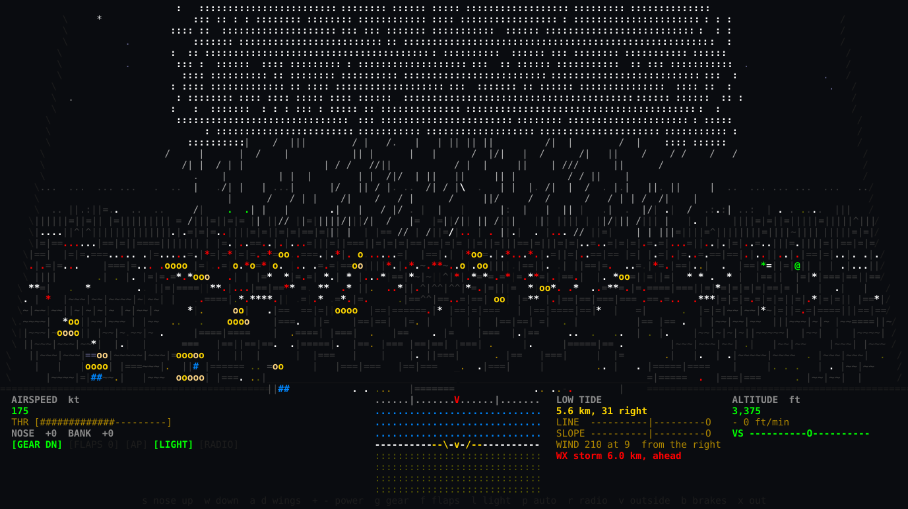

# ascii_city

An endless, procedurally generated city at night that you walk around in your terminal — and
fly over, and go into, and get lost in.



```bash
python3 ascii_city.py
```

One file of stdlib-only Python — `curses` and some arithmetic. No dependencies, no build step,
nothing saved. Inspired by [Grow Now! Games](https://youtu.be/3YtygAx_C6A).

<table>
  <tr>
    <td></td>
    <td></td>
  </tr>
  <tr>
    <td align="center"><sub>Chinatown — hung signs, lanterns, somebody smoking outside</sub></td>
    <td align="center"><sub>The casino — the wheel spins honestly</sub></td>
  </tr>
  <tr>
    <td></td>
    <td></td>
  </tr>
  <tr>
    <td align="center"><sub>Flying it yourself — on final, the instruments below</sub></td>
    <td align="center"><sub>The same approach from outside the jet</sub></td>
  </tr>
  <tr>
    <td colspan="2"></td>
  </tr>
  <tr>
    <td colspan="2" align="center"><sub>A thunderstorm six kilometres out, caught as it strikes</sub></td>
  </tr>
</table>

## For the best experience

**Use a GPU-accelerated terminal.** The city redraws the whole window many times a second, and
on a big window that is a lot of coloured text. [Ghostty](https://ghostty.org) is what it is made
and tested in; Kitty, WezTerm and Alacritty are built the same way. Older terminals work, but
can fall behind once the window gets large.

The settings that matter, from [`ghostty.conf`](ghostty.conf) — the rest of that file is taste:

```ini
# Ligatures off: the walls are made of ==, |= and --, and a coding font
# would melt them into single symbols
font-feature = -calt
font-feature = -liga
font-feature = -dlig

# A mono font with full block and box glyphs, a touch heavier so the
# stars, the rain and the snow read
font-family = JetBrains Mono
font-thicken = true

# Solid black: the night sky is the terminal's own background
background-opacity = 1
background = #000000

# A big window to start; the bigger the window, the more city
window-width = 200
window-height = 55
```

To use the whole file, copy its lines into your Ghostty config (`~/.config/ghostty/config`), or
add one line there pointing at it: `config-file = /path/to/ascii_city/ghostty.conf`.

And two things outside the terminal:

- **Go big.** At about 300×88 or more, the casino, the arcade, their games and the Pokemon Center
  switch to big layouts with block-letter figures (`z` toggles). Full screen and zoom out.
- **Run a recent Python.** It runs on 3.9, but 3.11 and newer draw a frame much faster. On a Mac,
  `/usr/bin/python3` is Apple's old 3.9; a Homebrew or python.org Python is the one to use.

## Controls

```
  w s        walk            a d     turn        , .   sidestep
  W S        run             + -     pace: normal, brisk, fast, very fast
  t          hail a taxi     e       lift a manhole cover, or take the metro
  tab        switch view     space   wander on its own
  `          cheat menu      q       quit
```

In the cockpit:

```
  s w        nose up, down   a d     bank        + -   throttle
  g          gear            f       flaps       b     brakes
  r          radio           p       autopilot   l     landing light
  m          map page        [ ]     map range   v     view from outside
  enter      a tug in, after landing             x     hand it back
             (at the gate, + pushes back; p taxis for you)
```

The cheat menu teleports you to anything worth looking at — it searches the city for what is
already there rather than spawning it, so the rare things stay exactly as rare as they are.

## What is in it

- **Two views** sharing one clock and one weather: the street, walked in first person, and the
  waterfront, the whole skyline seen from across the river.
- **Nine parts of town**, from downtown under the neon to Chinatown's night market, a financial
  district dark but for the cleaners' floor, the docks, the suburbs and the woods.
- **Weather that runs itself** — rain that comes and goes, rare and violent storms, fog nights,
  snow, a blackout, and a night sky with its own character every night.
- **Places to go into** — a casino, an arcade with six games, a bowling alley, a stock exchange,
  a cinema, a club, a temple, a library, ramen shops, a diner, rooftop bars and more.
- **A plane to fly** — real handling, a full cockpit, a tower that talks you down, an autopilot,
  flight plans to other airports, crosswinds, and thunderstorms out there you can fly into.
- **A river** with piers, rowing boats and a carnival, and a bay with a suspension bridge and a
  lighthouse you can climb.
- **Secrets** — tunnels under every street, somebody living down a manhole, a mystery that starts
  with a note, and things in the woods you will not like.

You start the night with $1,000, one balance for everything, and nothing tops it up.

Nothing is stored. Every street, building, sign and trail is a hash of its own coordinates, so
the city is infinite, identical every time you walk back to it, and held in no memory at all.

<details>
<summary><b>Everything, in full</b></summary>

### Around town

- **Nine parts of town** — downtown under the neon, quiet housing, Chinatown and a night market
  strung with lanterns, a financial district that is black but for the floor the cleaners are on,
  the docks, the old town, and small parks.
- **People out walking** — not many, it is night — under umbrellas when it rains.
- **Traffic on the wide streets**, headlights and tail lights, the odd bus — and now and then a
  police car, its lights washing the street red and blue. Most of it is up on **the highway**, an
  elevated deck running straight through the city on piers, over the river and all.
- **An elevated train** over some of the avenues, rattling along with its windows lit, and from
  across the water a row of lights sliding through the town.
- **Taxis** you can hail on any street and ride across town, and **a metro**, its lit M at the
  kerb, a platform and a train to anywhere for $3.
- **Billboards** hung out over the wide streets, selling soda in neon.
- **Car parks** under orange sodium lamps, and **tunnels** under the road decks — under the short
  ones, a fire in a can.
- **Dark alleys**, some of which dead-end, and lit ones lined with tiny bars — and fire escapes
  you can climb to the roof.
- **Up on the roofs**, some with somebody's something on them: a pigeon loft to feed and send
  notes from, a garden, a line of washing — and across the residential streets, more washing.
- **Sky decks**: ride the lift to the roof of the tallest towers and look out over the whole city,
  every tower's crown lit in the colour of the weather; and **rooftop bars** with the real skyline
  behind them, a drink off the wallet, a trio and a bartender with opinions.
- **A landmark skyscraper** a whole block wide in every part of the city, stepped like the old Art
  Deco towers with a spire on top, and a techno party on its roof, its lasers out over the city.
- **The Strip** — casino-hotels in towers of light, palms and dancing fountains down the median,
  and a fountain show on a lake in front of one of them.
- **The suburbs** — curving streets, white picket fences, lawns and porch lights, a lemonade stand
  open at 3am, and an old man with a telescope.
- **An industrial zone** of sheds and smoking chimneys, with a building site and a rave in the old
  factory.
- **A university quarter** of ivied brick round a quad, its clock tower showing the real time.

### Places to go into

- **A casino** — a blade sign up the corner, a red carpet and a doorman, and the whole building in
  gold when somebody hits 777. Inside, a roulette wheel that spins honestly, a slot machine, a
  blackjack table that deals straight, a plinko machine with up to 1000x on its outside edges,
  horse races to bet on and a High Flyer crash game.
- **An arcade** whose front is one big wall of flashing coloured lights, and six games inside: a
  rooftop runner, a neon tube puzzle, a delivery run, a racer, a fireworks show and an owl
  catching moths.
- **A bowling alley** under the black light: ten frames, aim and spin, and ten real pins knocking
  into each other, so a strike is earned and so is a split.
- **A stock exchange**, its ticker running across the front in green and red, and inside a trading
  floor with sixteen made-up stocks to buy and sell as they move every thirty seconds — bull and
  bear markets, sectors and hot streaks.
- **A cinema** showing a black-and-white film or a full-colour action picture, the title over the
  doors in big lit letters and searchlights sweeping the sky from its roof.
- **A club** with no sign, but a queue, a bouncer and a rope. The windows next door shake on the
  kick, the puddles ripple, and at closing time everyone spills out into the street.
- **A temple** with stained glass and a rose window, where a terminal on the altar gives you the
  word of God the way TempleOS did, and a priest in the confession booth hears what you type.
- **A library** with a reading room: a Wikipedia reader and a PsychonautWiki one.
- **A Pokemon Center** or two, Nurse Joy at the counter and a PC with a type chart on it.
- **Ramen shops** down the lit lanes, a neon bowl over the door, where you can sit and wait for
  your bowl; and **an all-night cyberpunk diner** with a giant neon coffee cup steaming on its
  roof, where a drone comes round with the coffee.

### Flying

- **An airport** where airliners land over your head and take off, and a sightseeing flight from
  it: a window seat once round the town, past the Strip and back down.
- **Or fly it yourself** — real handling, a cockpit with its instruments, the whole horizon tilting
  as you bank, and a grade for how you met the ground.
- **A flight plan** to another airport, and a tower on the radio that clears you, gives you
  headings and talks you down — and a flight director and an autopilot that fly its way.
- **Flaps and gear** (forget the gear and it is a belly landing), **a crosswind** every night,
  and runways lit from a long way off — two at every airport, and the tower gives you the one
  into the wind. You start at a gate: push back, taxi out along the yellow lines to the runway,
  and after landing taxi in to a gate — or let the autopilot do it.
- **A view from outside** the jet, and **a landing light** that picks out the runway's paint.
- **A moving map** in the panel, one page at a time — the way, with the runways and the other
  traffic, or the weather radar — and a
  **landing report** after every touchdown: how hard, how straight, where, and what to fix.
- **Height callouts** on the way down — 1000, 500, 100, then every ten feet from 50 — and, one
  flight in eight, **something goes wrong**: an engine in the cruise, birds on the climb out (one
  engine, or now and then both), or a truck on the runway on short final. Book a **check ride**
  at the desk (`t`) and the instructor makes sure of it.
- **A fuel tank** that the engines drink from, a gauge with the range it gives you, and a
  **fuel pad** at every airport: `k` taxis you there and fills you up — before you go, or on a
  stop along the way. Run it dry and you are a glider.
- **Thunderstorms** out over the country that you can see from far off and fly into — or let the
  tower take you round.
- **Other traffic** — airways full of flights at their own heights and every airport busy with
  arrivals and departures; the tower calls the ones near you, a TRAFFIC warning when one is close,
  and if a departure is still rolling when you come in, you are number two or sent round.

### On the water

- **A river**, with a promenade along it, piers, buoys, rowing boats drifting down with lanterns
  in them, mist on cold nights and footbridges with lamps along them.
- **A carnival** on the bank — always one beside the big bridge, out on a pleasure pier with a
  drop tower and a roller coaster — with a big wheel turning over the water, a claw machine
  (`p` to start, `p` to drop) and a strength tester (`p` to swing the hammer).
- **A bay** once in a long way, with a suspension bridge across it, lights the length of its
  cables, a ferry crossing beside it to a headland, and a lighthouse at the point whose beam goes
  round over all of it. Climb it, and up on its gallery `f` lights a fireworks show that you fire,
  one shell for every press on the beat.
- One night in a dozen the river is lanterns, and now and then there are fireworks over the bay.

### Weather and the sky

- **Rain** that comes and goes, **storms** that are rare, violent and the only thing that brings
  lightning, and rarer still **snow** that settles on the whole city.
- **Fog nights**, when the neon goes soft and the far end of the street is gone, and **a
  blackout** one night in a while, when the power goes block by block and comes back in a wave.
- **A night sky with a different character every night** — clarity, the moon's phase, whether the
  milky way is up, the odd meteor, cloud coming and going. Now and then a night ends in a dawn, the
  city switching off sign by sign as the sky pales. Once in a great while, something else entirely.

### Underneath, and further out

- **Manholes** in the streets, some of them steaming, and **tunnels** under every street, with a
  ladder at every manhole — and somebody's door down there, if you can find it.
- **A mystery** that starts with a note and goes all over the city.
- **The woods** — one great block of trees, a long walk from anywhere, with trails you can get
  lost on, a lake with the stars in it, things in the dark with eyes, and once in a while a rave in
  the hollow in the middle that nobody asked permission for. Somebody there is not dancing, and
  you will not like who is on the decks.

</details>

## Tests

```bash
python3 tests/checks.py && python3 tests/pty_checks.py
```

A few hundred assertions, no framework and nothing to install. The first renders frames and counts
what landed where; the second forks a pty and actually plays the thing, six games at a time.

The screenshots are generated the same way — `python3 tools/screenshot.py` renders real frames
and writes them out as text in an SVG, in the colours the renderer actually picked.

## Notes

`CLAUDE.md` is the long version: how the renderer works, why particular decisions were made, and
the traps that cost time.

Written for fun, with [Claude Code](https://claude.com/claude-code).
