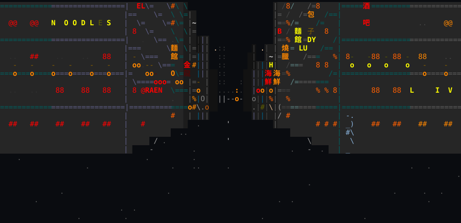
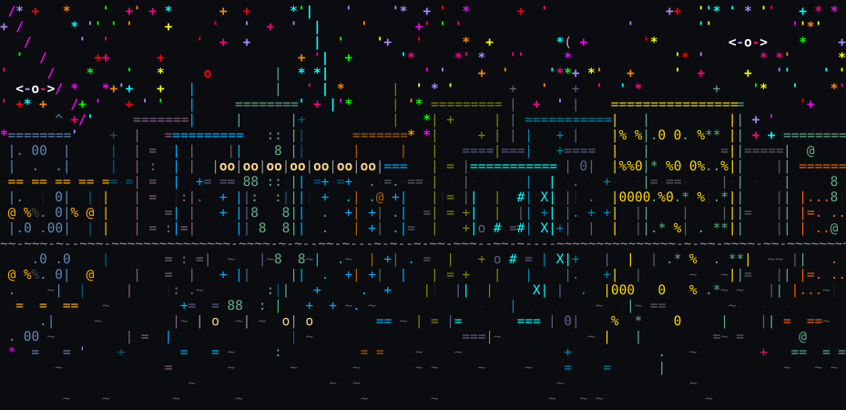

# ascii_city

Inspired by [Grow Now! Games](https://youtu.be/3YtygAx_C6A).

An endless, procedurally generated city you can walk around in your terminal.

```bash
python3 ascii_city.py
```

Stdlib-only Python — `curses` and some arithmetic, no dependencies, no build step.



*A street in Chinatown — hung signs, lanterns, somebody smoking outside.*



*The waterfront on a clear night, with the milky way up.*

## What is in it

Two views, sharing one clock and one weather: **the street**, walked in first person with free
turning, and **the waterfront**, the whole city seen from across the water. `tab` switches.

- **Nine parts of town** — downtown under the neon, quiet housing, Chinatown and a night market
  strung with lanterns, a financial district that is black but for the floor the cleaners are on,
  the docks, the old town, and small parks.
- **Weather that runs itself** — rain that comes and goes, storms that are rare, violent, and
  the only thing that brings lightning, and rarer still, snow that settles on the whole city.
- **A night sky with a different character every night** — clarity, the moon's phase, whether the
  milky way is up, the odd meteor, cloud coming and going. Now and then a night ends in a dawn, the
  city switching off sign by sign as the sky pales. Once in a great while, something else entirely.
- **Places you can go into** — a casino (a blade sign up the corner, a red carpet and a doorman,
  and the whole building in gold when somebody hits 777) with a roulette wheel that spins
  honestly, a slot machine, a blackjack table that deals straight and a
  plinko machine with 120x on its outside edges, horse races to bet on, a club
  with a rave going
  on, a temple with stained glass and a rose window, where a terminal on the altar
  gives you the word of God the way TempleOS did and a priest in the confession
  booth hears what you type, a blackout one night in a while, when the power goes block by block and comes
  back in a wave, manholes in the streets, some of them steaming, with somebody living down one
  of them, steaming ramen shops down the lit lanes, a neon bowl over the door, where you can sit
  and wait for your bowl, a cinema
  showing a black-and-white film or a full-colour action picture, with the title up over the doors in big lit letters and
  searchlights sweeping the sky from its roof, an arcade with a front that is one big wall of
  flashing coloured lights and six games inside to play (a rooftop runner, a neon tube
  puzzle, a delivery run, a racer, a fireworks show and an owl catching moths), an all-night cyberpunk diner
  with a giant neon coffee cup steaming on its roof, where a drone comes round with the coffee,
  and sky decks: ride the lift to the roof of the tallest towers and look out over the whole city,
  where every
  tower's crown is lit in the colour of the weather. The club still has no sign, but there is a
  queue, a bouncer and a rope, and now and then the door opens and lets the light out; the
  windows next door shake on the kick, the puddles ripple, and at closing time the lights come
  up and everyone spills out into the street.
- **A stock exchange** in the financial district, its ticker running across the front in green
  and red, and inside a trading floor with sixteen made-up stocks - charts or a list - to buy and sell
  as they move every thirty seconds, with bull and bear markets, sectors and hot streaks.
- **A landmark skyscraper** a whole block wide in every part of the city, stepped like the old
  Art Deco towers with a spire on top, and a techno party on its roof that you can walk about in,
  its lasers going out over the city.
- **People out walking** — not many, it is night — under umbrellas when it rains.
- **Traffic on the wide streets**, headlights and tail lights, the odd bus — and now and then a
  police car, its lights washing the street red and blue. Most of it is up on **the highway**, an
  elevated deck running straight through the city on piers, over the river and all.
- **Billboards** hung out over the wide streets, selling soda in neon.
- **Car parks** here and there, under orange sodium lamps, the bays half full.
- **Tunnels** under the road decks, short and long — and under the short ones, a fire in a can.
- **An elevated train** over some of the avenues, rattling along with its windows lit, and from
  across the water a row of lights sliding through the town.
- **Dark alleys**, some of which dead-end, and lit ones lined with tiny bars — and fire escapes
  you can climb to the roof.
- **The woods** — one great block of trees, a long walk from anywhere, with trails you can get
  lost on, a lake with the stars in it, things in the dark with eyes, and once in a while a rave in
  the hollow in the middle that nobody asked permission for. Somebody there is not dancing, and
  you will not like who is on the decks.
- **A river**, with a promenade along it, piers, buoys, rowing boats drifting down with lanterns in
  them, mist on cold nights, footbridges with lamps along them, now and then a carnival on the bank
  (always one beside the big bridge, out on a pleasure pier with a drop tower and a roller
  coaster) with a big wheel turning over the
  water, a claw machine you can play (`p` to start, `p` to drop) and a strength tester (`p`
  to swing the hammer), and once in a long way a bay
  with a suspension bridge
  across it, lights the length of its cables, a ferry crossing beside it, landing on a headland -
  the only way onto it - with a lighthouse at the point whose
  beam goes round over all of it, and you can climb the lighthouse: up on its gallery `f`
  lights a show, and you fire it, one shell for every press on the beat. One night in a dozen the river is lanterns, and
  now and then there are fireworks over the bay.

You start the night with $1,000, one balance for everything - the casino, the exchange, the
arcade, the carnival, a seat at the pictures, a bowl of ramen - and nothing tops it up.

Nothing is stored. Every street, building, sign and trail is a hash of its own coordinates, so
the city is infinite, identical every time you walk back to it, and held in no memory at all.

## Controls

```
  w s        walk            a d     turn        , .   sidestep
  tab        switch view     space   wander on its own
  `          cheat menu      q       quit
```

The cheat menu teleports you to anything worth looking at — it searches the city for what is
already there rather than spawning it, so the rare things stay exactly as rare as they were.

## Tests

```bash
python3 tests/checks.py && python3 tests/pty_checks.py
```

A few hundred assertions, no framework and nothing to install. The first renders frames and counts
what landed where; the second forks a pty and actually plays the thing.

The screenshots above are generated the same way — `python3 tools/screenshot.py` renders a frame and
writes it out as text in an SVG, in the colours the renderer actually picked.

## Notes

`CLAUDE.md` is the long version: how the renderer works, why particular decisions were made, and
the traps that cost time.

Written for fun, with [Claude Code](https://claude.com/claude-code).
